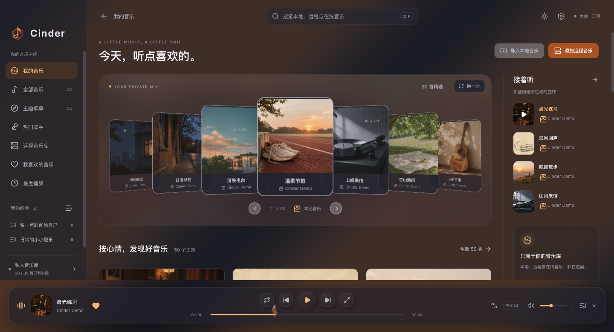
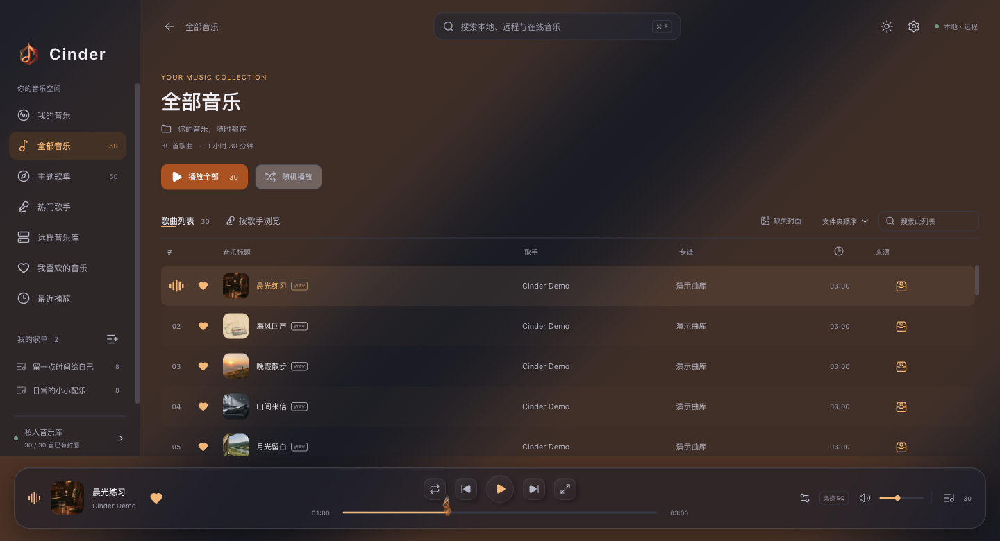
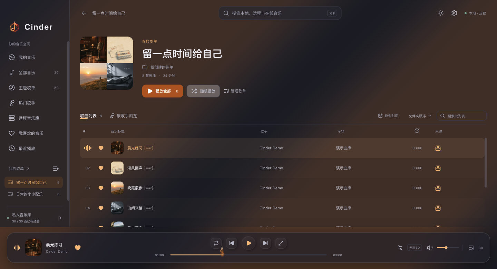
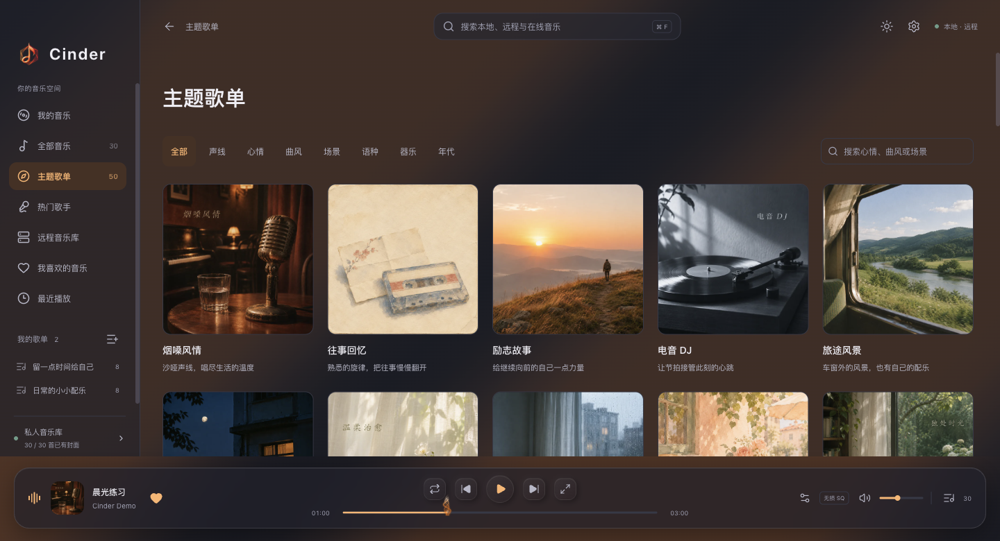
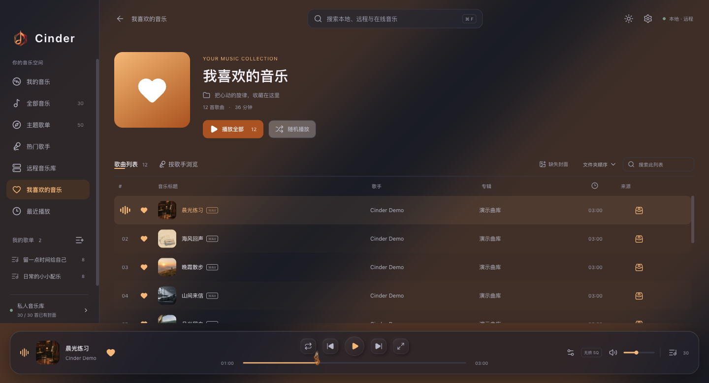
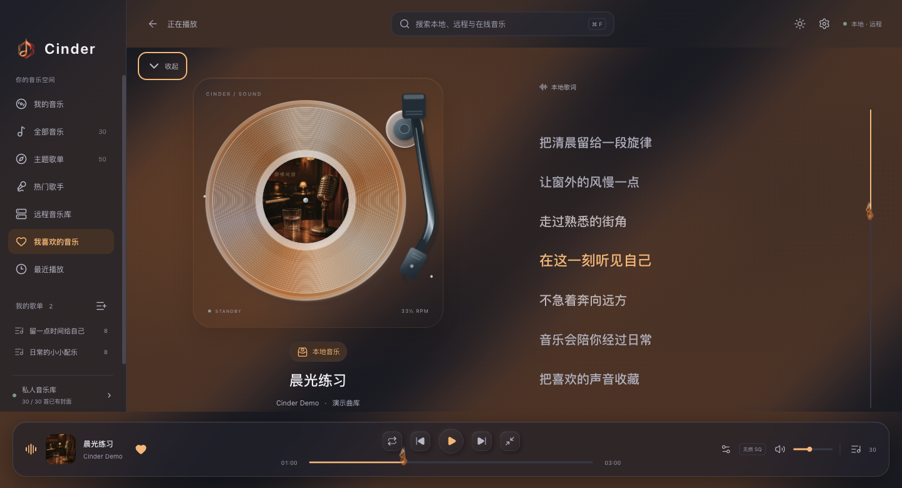
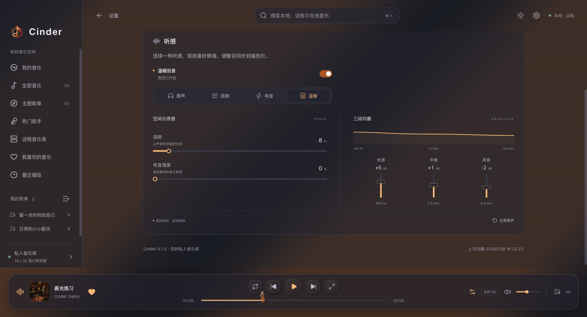

<p align="center">
  
</p>

<h1 align="center">Cinder</h1>
<h3 align="center">把散落的音乐，放在一起。</h3>

<p align="center">
  你的私人音乐空间。<br />
  从电脑文件夹到自己的音乐服务器，让找歌、整理与聆听连成一件事。
</p>

<p align="center">
  <strong>macOS · Apple Silicon / Intel</strong> &nbsp; / &nbsp;
  <strong>Windows x64 · 候选版</strong> &nbsp; / &nbsp;
  <a href="LICENSE">MIT License</a>
</p>

<p align="center">
  <a href="README.assets/home.png"></a>
</p>

<table>
  <tr>
    <td width="33%" valign="top"><h3>一个入口</h3><p>本地与远程曲库集中浏览，收藏、歌单与播放队列都在一处。</p></td>
    <td width="33%" valign="top"><h3>50 种主题</h3><p>按心情、风格和场景探索歌曲，不必每次都从搜索开始。</p></td>
    <td width="33%" valign="top"><h3>接着上次听</h3><p>保存播放队列与进度，下一次打开，继续自己的节奏。</p></td>
  </tr>
</table>

## 音乐多一点，整理少一点。

喜欢的音乐可能分散在文件夹、NAS 和音乐服务器里。Cinder 把这些入口放在一起，保留你整理音乐的习惯，省去来回切换工具和翻找目录的时间。

- **自己的曲库，自己管理**：导入本地文件夹，连接 SFTP / SSH、Navidrome / Subsonic 音乐库。
- **喜欢怎样归类，就怎样保存**：收藏、自建歌单、最近播放和统一队列，为通勤、工作与休息留一份熟悉的声音。

<table>
  <tr>
    <td width="50%"><a href="README.assets/library.png"></a></td>
    <td width="50%"><a href="README.assets/playlist.png"></a></td>
  </tr>
  <tr>
    <td align="center"><strong>全部音乐，一眼找到</strong></td>
    <td align="center"><strong>自己的歌单，随心归类</strong></td>
  </tr>
</table>

## 按心情发现，把喜欢留下。

有时想听某首歌，有时只是想换一种心情。从主题、歌手或搜索进入音乐，把偶然听见的喜欢留在收藏里。

<table>
  <tr>
    <td width="50%"><a href="README.assets/themes.png"></a></td>
    <td width="50%"><a href="README.assets/favorites.png"></a></td>
  </tr>
  <tr>
    <td align="center"><strong>50 种聆听主题</strong></td>
    <td align="center"><strong>我喜欢的音乐</strong></td>
  </tr>
</table>

## 把听感，调成自己的样子。

从一张封面进入一首歌。彩胶唱机、同步歌词与音浪，让正在播放的音乐成为视觉中心；音效预设、混响和三段均衡，则让声音更合自己的习惯。

浅深外观、多种配色与全局切歌快捷键，让音乐自然地融入日常桌面。

<table>
  <tr>
    <td width="50%"><a href="README.assets/playback.png"></a></td>
    <td width="50%"><a href="README.assets/sound.png"></a></td>
  </tr>
  <tr>
    <td align="center"><strong>封面、唱机与同步歌词</strong></td>
    <td align="center"><strong>自己的音色与空间</strong></td>
  </tr>
</table>

## 开始使用

| 你的设备                  | 选择的版本 | 当前状态                               |
| ------------------------- | ---------- | -------------------------------------- |
| macOS 13+ · Apple Silicon | arm64 DMG  | 原生验证通过                           |
| macOS 13+ · Intel         | x64 DMG    | Rosetta 验证通过，真实 Intel 验证待 CI |
| Windows 10 / 11 · x64     | ZIP 便携版 | 已交叉构建，待 Windows 环境验收        |

1. Mac 打开 DMG 后拖入“应用程序”；Windows 完整解压 ZIP 后运行 `Cinder.exe`。
2. 添加自己的音乐文件夹，或连接已有音乐服务器。
3. 选一首喜欢的歌开始播放，把想留下的声音加入收藏和歌单。

安装包尚未做官方开发者签名，首次启动可能出现系统来源提示。

<details>
<summary><strong>从源码运行与开发</strong></summary>

需要 Node.js 22.12+ 和 npm。

```bash
git clone https://github.com/SKT-Shurima/Cinder.git cinder
cd cinder
npm ci
npm run build
npm start
```

```bash
npm run format       # 按统一风格整理源码
npm run format:check # 检查排版
npm run lint         # 检查引用、未使用代码与模块边界
npm test             # 运行单元测试
npm run package      # 打包当前系统与架构
npm run smoke        # 验证本机打包应用
```

源码按职责组织：

```text
electron/   桌面启动、应用服务、系统适配与受限 IPC
shared/     两端共用的纯业务规则与配置
src/app/    应用装配、导航、页面分发与弹层宿主
src/features/  曲库、播放、账号、服务器、封面与设置
src/shared/    通用组件、桌面接口与展示工具
scripts/    启动、构建、打包与跨平台验证
```

组件使用 `PascalCase.jsx`，普通模块使用 `camelCase.js`，Hook 使用 `useCamelCase.js`；预加载入口保留 `preload.cjs`。共享规则通过 `#shared` 导入，界面模块通过 `@` 导入。功能目录内区分组件、Hook 与纯规则，测试跟随所属模块。

构建和验证产物保存在项目外。打包脚本分别支持 `package:mac:apple`、`package:mac:intel` 和 `package:win`。

</details>

## 项目说明

Cinder 是由 SKT-Shurima 维护的个人开源学习项目，面向希望集中整理个人曲库、连接自建音乐服务器并专注聆听的用户，也可作为桌面音乐应用开发的学习参考。

仓库提供播放器代码，不附带商业音乐、歌词库或平台账号。在线平台接入属于实验功能，与相关平台不存在隶属或官方合作关系。

<details>
<summary><strong>联网与账号说明</strong></summary>

- 在线资源受账号权限和平台接口变化影响，请仅访问自己有权使用的内容。
- 获取在线歌词和封面时，会发送歌名、歌手等信息；当前音乐来源开关不能完全阻止这些查询。
- 在线登录仍存在本地会话明文保存及缺少清除入口的问题，建议使用测试账号。源码和安装包不包含个人曲库或登录数据。

</details>

## License

[MIT License](LICENSE) · Copyright (c) 2026 SKT-Shurima

允许使用、复制、修改和再分发，包括商业用途；须保留版权及许可声明。软件按“现状”提供，不作保证。第三方依赖、音乐、歌词、封面及商标继续适用各自的权利与许可。

<p align="center"><strong>Cinder · 让音乐回到生活里。</strong></p>
